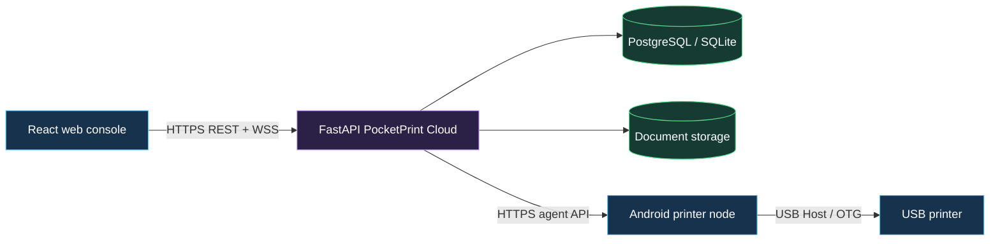
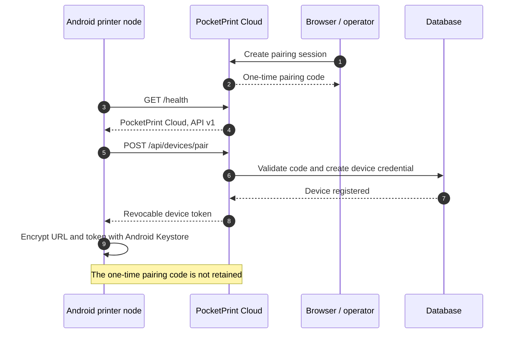
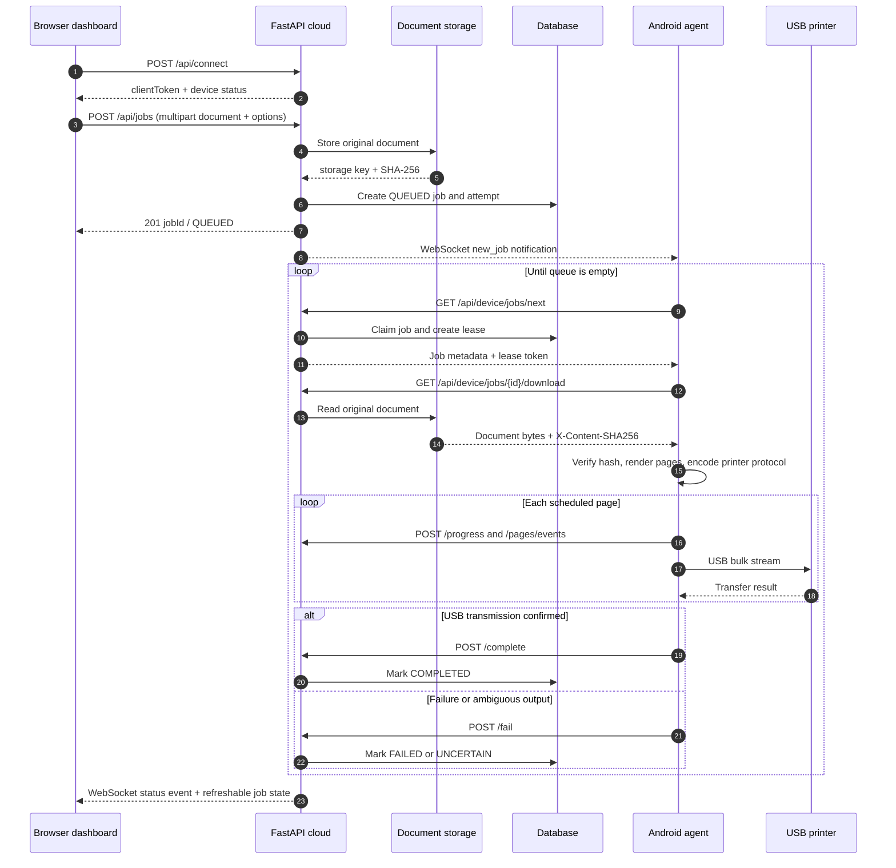
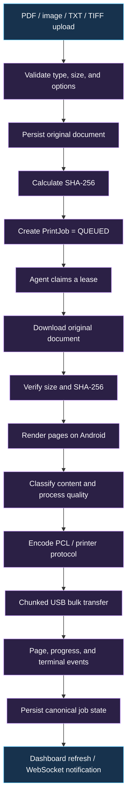
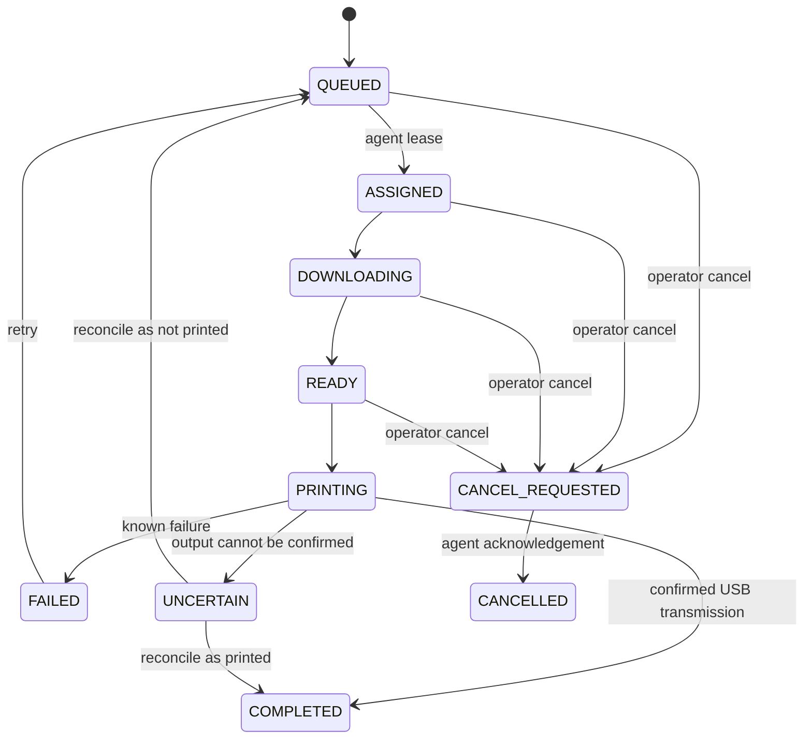

# PocketPrint

### Turn an Android USB printer into a secure Wi-Fi printer

PocketPrint connects a USB printer to an Android device and exposes it through a
FastAPI cloud service and a browser dashboard. The Android device remains the
printer node: it discovers the USB printer, renders and encodes documents, and
streams the final bytes over USB. The cloud service stores jobs and coordinates
delivery; it does not pretend to be the USB printer.

> **Project status:** active proof-of-concept / production-oriented architecture
> **API version:** `1`
> **Android target:** Android 8.0+ with USB Host / OTG support

<p align="center">
  <strong>Browser dashboard</strong>
  &nbsp; → &nbsp;
  <strong>FastAPI job cloud</strong>
  &nbsp; → &nbsp;
  <strong>Android printer node</strong>
  &nbsp; → &nbsp;
  <strong>USB printer</strong>
</p>

## What it does

- Detects USB Printer Class 7 and compatible bulk-transfer printers without
  hard-coded manufacturer IDs.
- Supports local Android printing and remote print jobs from the web console.
- Stores original documents with SHA-256 integrity metadata.
- Uses leases, retries, idempotency keys, progress events, and explicit
  uncertain outcomes for reliable remote printing.
- Renders PDF, common raster images, TXT, and selected TIFF inputs on Android.
- Supports print options such as paper size, orientation, copies, scaling,
  margins, page ranges, quality, DPI, collation, and pages per sheet.
- Streams live device/job notifications over short-lived-ticket WebSockets.

## Architecture



### Repository map

| Area | Responsibility |
| --- | --- |
| [`app/`](./app) | Native Kotlin Android app, USB discovery, rendering, queueing, and printing |
| [`backend/app/`](./backend/app) | FastAPI routes, authentication, device leases, job state, storage, and WebSockets |
| [`frontend/src/`](./frontend/src) | React/Vite dashboard for connection, upload, queue, and job control |
| [`web/`](./web) | Server-served dashboard assets |
| [`deploy/`](./deploy) | Nginx and service deployment configuration |
| [`docs/`](./docs) | Architecture, quality, and hardware validation notes |

## Animated API flow

The diagrams below are intentionally embedded in this README. GitHub renders
the Mermaid `sequenceDiagram` as a visual step-by-step flow; `loop` blocks show
the repeating heartbeat, queue polling, and event animation.

### First-time pairing



### Print job API flow



### GitHub-compatible animated flow

GitHub strips executable JavaScript and arbitrary CSS from README HTML, so a
`<script>` or `<style>` animation cannot run here. This inline SVG uses native
SVG animation instead: the moving signal dot represents a document travelling
from the dashboard to the USB printer. Browsers that disable SVG animation still
show the labeled static flow below it.

<details open>
<summary><strong>▶ Watch the document flow</strong></summary>

<svg viewBox="0 0 960 180" role="img" aria-labelledby="flow-title flow-desc" width="100%" xmlns="http://www.w3.org/2000/svg">
  <title id="flow-title">Animated PocketPrint document flow</title>
  <desc id="flow-desc">A document moves from the browser dashboard through the cloud and Android agent to the USB printer.</desc>
  <rect x="20" y="55" width="180" height="70" rx="14" fill="#17324d" stroke="#57c7ff" stroke-width="2"/>
  <rect x="260" y="55" width="180" height="70" rx="14" fill="#2b2045" stroke="#c79cff" stroke-width="2"/>
  <rect x="500" y="55" width="180" height="70" rx="14" fill="#2b2045" stroke="#c79cff" stroke-width="2"/>
  <rect x="740" y="55" width="180" height="70" rx="14" fill="#153b32" stroke="#58d68d" stroke-width="2"/>
  <g fill="#ffffff" font-family="Arial, sans-serif" font-size="16" text-anchor="middle">
    <text x="110" y="85">Browser dashboard</text>
    <text x="350" y="85">FastAPI cloud</text>
    <text x="590" y="85">Android agent</text>
    <text x="830" y="85">USB printer</text>
  </g>
  <g stroke="#8ba3b5" stroke-width="3" fill="none">
    <path d="M200 90H260"/>
    <path d="M440 90H500"/>
    <path d="M680 90H740"/>
  </g>
  <g fill="#8ba3b5">
    <path d="M260 90l-12-7v14z"/>
    <path d="M500 90l-12-7v14z"/>
    <path d="M740 90l-12-7v14z"/>
  </g>
  <circle r="8" fill="#ffd166">
    <animateMotion dur="5s" repeatCount="indefinite" path="M110,90 L350,90 L590,90 L830,90 L590,90 L350,90 L110,90"/>
  </circle>
  <text x="480" y="30" fill="#6b7280" font-family="Arial, sans-serif" font-size="14" text-anchor="middle">upload → queue → render → print</text>
</svg>

</details>

## Data flow



### Canonical remote job state



## API surface

All remote agent calls use `X-Device-Token`. Browser client calls use the
short-lived client token as `Authorization: Bearer <token>`. WebSocket
connections use short-lived scoped tickets instead of long-lived credentials.

| Capability | Method | Endpoint |
| --- | --- | --- |
| Health | `GET` | `/health` |
| Readiness | `GET` | `/ready` |
| Browser connection | `POST` | `/api/connect` |
| Device status | `GET` | `/api/connect/device` |
| Browser WebSocket ticket | `POST` | `/api/connect/ws-ticket` |
| Create print job | `POST` | `/api/jobs` |
| List/detail jobs | `GET` | `/api/jobs`, `/api/jobs/{job_id}` |
| Cancel/retry/reconcile | `POST` | `/api/jobs/{job_id}/cancel`, `/retry`, `/reconcile` |
| Pair Android device | `POST` | `/api/devices/pair` |
| Agent heartbeat | `POST` | `/api/devices/{device_id}/heartbeat` |
| Claim next job | `GET` | `/api/device/jobs/next` |
| Download document | `GET` | `/api/device/jobs/{job_id}/download` |
| Renew lease | `POST` | `/api/device/jobs/{job_id}/lease/renew` |
| Agent progress | `POST` | `/api/device/jobs/{job_id}/progress` |
| Page event | `POST` | `/api/device/jobs/{job_id}/pages/events` |
| Complete/fail/cancel acknowledgement | `POST` | `/api/device/jobs/{job_id}/complete`, `/fail`, `/cancel/ack` |
| Device WebSocket | `WS` | `/ws/device/{device_id}?ticket=...` |
| User WebSocket | `WS` | `/ws/user/{user_id}?ticket=...` |

Interactive OpenAPI documentation is available at `/api/docs` when the backend
is running.

## Security model

- Never commit `.env` files, database files, uploaded documents, Android
  signing keys, private certificates, or real access tokens.
- Use the tracked `.env.example` files only as templates; copy them to ignored
  local `.env` files and replace all placeholders.
- Release signing keys are intentionally not included. The previously tracked
  release keystore has been removed and must not be reused; generate a new
  private signing key and keep it outside this repository.
- Remote Android connections require HTTPS; HTTP is accepted only for loopback
  development URLs.
- Android stores the device password and device token in
  `EncryptedSharedPreferences` backed by Android Keystore.
- Browser sessions are revocable and scoped to a paired device.
- Agent downloads require both a device token and an active job lease token.
- WebSocket tickets are short-lived and scoped to one device or user channel.
- Uploaded documents are checked for supported structure and stored with
  integrity metadata.
- Production deployments should replace every development password and secret
  in environment configuration.

## Local development

### Backend

Use Python 3.11+ and create the virtual environment outside version control.
Copy the safe template to a local, ignored `.env` file and replace the
placeholder secret before running:

```powershell
cd backend
Copy-Item .env.example .env
python -c "import secrets; print(secrets.token_urlsafe(48))"
# Put the generated value in SECRET_KEY in backend/.env
python -m venv .venv
.\.venv\Scripts\Activate.ps1
pip install -r requirements.txt
uvicorn backend.app.main:app --reload --host 0.0.0.0 --port 8000
```

The backend uses SQLite by default for local development. PostgreSQL is
configured through `DATABASE_URL` for deployment. Never commit `.env` files,
database files, uploaded documents, or production credentials.

For Docker Compose, copy the repository-root `.env.example` to `.env` and
set unique values for `POSTGRES_PASSWORD`, `POCKETPRINT_SECRET`,
`CORS_ALLOWED_ORIGINS`, and `TRUSTED_HOSTS` before starting the stack.
Compose intentionally refuses to start when required production values are
missing.

### React dashboard

```powershell
cd frontend
npm install
npm run dev
```

Set `VITE_API_BASE_URL` when the dashboard is served separately from the
backend. When served by the backend, same-origin `/api` requests are used.

### Android app

Debug builds do not require a release signing key. Release signing credentials
must be supplied through the environment variables
`POCKETPRINT_KEYSTORE_PATH`, `POCKETPRINT_KEYSTORE_PASSWORD`,
`POCKETPRINT_KEY_ALIAS`, and `POCKETPRINT_KEY_PASSWORD`. Keep the keystore
outside the repository and store its credentials in a secret manager or local
environment. Do not commit signing keys or passwords.

```powershell
.\gradlew.bat assembleDebug
adb install -r app\build\outputs\apk\debug\app-debug.apk
adb shell am start -n com.pocketprint/.ui.main.MainActivity
adb logcat -s PocketPrint:V
```

Connect a printer through a USB OTG adapter, grant Android USB permission, and
use **Test Interface Claim** in the app before sending physical output.

### Docker deployment

```powershell
docker compose up --build -d
```

The compose stack starts PostgreSQL and the FastAPI service on port `8000`.
Use [`deploy/nginx.conf`](./deploy/nginx.conf) for HTTPS termination, upload
limits, and WebSocket proxying.

## Testing

```powershell
.\gradlew.bat :app:testDebugUnitTest
cd backend
pytest
cd ..\frontend
npm run lint
npm run build
```

Physical printer compatibility still requires the manual checks described in
[`docs/MANUAL_HARDWARE_CHECKLIST.md`](./docs/MANUAL_HARDWARE_CHECKLIST.md) and
[`USB_COMPATIBILITY_REPORT.md`](./USB_COMPATIBILITY_REPORT.md).

## Current limitations

- Physical HP Ink Tank 310 validation is separate from automated tests.
- DOCX, XLSX, PPTX, and RTF should be printed from their source viewer so the
  server receives a layout-faithful PDF.
- Legacy binary Office and OpenDocument formats are not supported.
- Some TIFF variants (tiled, planar, non-top-left orientation, and unsupported
  fax compression) are rejected explicitly.

See [`docs/PRINT_ENGINE_ARCHITECTURE.md`](./docs/PRINT_ENGINE_ARCHITECTURE.md),
[`PHASE5_USB_STREAMING.md`](./PHASE5_USB_STREAMING.md), and
[`docs/PRINT_QUALITY_REPORT.md`](./docs/PRINT_QUALITY_REPORT.md) for deeper
implementation notes.

## License

No license file is currently included in this repository. Add a license before
redistributing the project.
